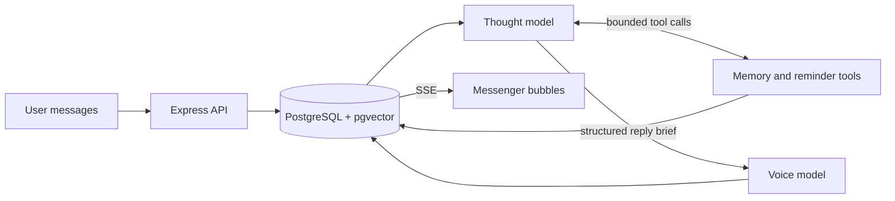
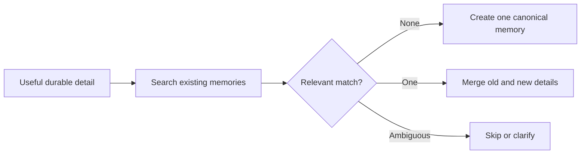

# Cantarella

> A messenger-first personal AI companion with durable memory, natural reminders, and a two-pass Thought → Voice pipeline.

Cantarella is built to feel like an ongoing private conversation—not a prompt box or command-driven chatbot. Each user has one continuous chat, one evolving persona, and a memory system that quietly preserves useful context over time.

The current V1 is a desktop web application with authenticated onboarding, real-time messaging, configurable personality, long-term memory, conversation summaries, and reminders delivered back into the chat.

## Why Cantarella?

Most AI chat interfaces expose the machinery: new chats, model selectors, tool confirmations, and isolated sessions. Cantarella takes the opposite approach.

- **One continuous relationship** — no disposable chat threads
- **Messenger behavior** — ordinary bubbles, typing feedback, delivery states, and paginated history
- **Natural memory** — facts are learned, corrected, retrieved, and forgotten through normal conversation
- **Separate thought and voice** — one model decides what matters; another decides how Cantarella says it
- **Invisible application actions** — memory and reminder operations never turn the conversation into a control panel

## Features

| Area | Current V1 behavior |
| --- | --- |
| Authentication | Auth0 SPA login with backend JWT validation |
| Onboarding | Timezone, preferred name, voice direction, custom style, and boundaries |
| Conversation | One persistent Cantarella chat per user |
| Messaging | Nearby-message batching, ordered multi-bubble replies, pagination, and virtualized rendering |
| Real-time state | Server-Sent Events for seen state, typing, new bubbles, completion, and failure |
| AI pipeline | Configurable Thought model followed by a separate Voice model |
| Persona | Fixed core SOUL with per-user voice additions and higher-priority boundaries |
| Memory | Automatic and manual create, retrieve, update, and delete with semantic search |
| Summaries | Immutable chunks compress older conversation history without repeatedly shrinking one summary |
| Reminders | Natural chat operations, recurrence, persistent scheduling, and persona-aware delivery |
| Reliability | Idempotent sends, persistent jobs, bounded retries, stale-job recovery, and visible failures |

## How it works



### 1. Messages become a turn

The client stores each user bubble immediately. Messages sent close together enter the same short collection window, allowing someone to text naturally across several bubbles while Cantarella receives one coherent turn.

### 2. Thought decides meaning and actions

The Thought model receives the current batch, recent conversation, older summary context, local time, and bounded application tools. It resolves the user's meaning, performs any needed memory or reminder work, and returns compact semantic reply points.

### 3. Voice becomes Cantarella

The Voice model receives the grounded brief, recent conversational context, Cantarella's core SOUL, and the user's persona additions. It chooses the final phrasing and how many visible bubbles feel natural.

### 4. The result arrives like a message

Assistant bubbles are stored durably and emitted in order through Server-Sent Events. The frontend shows seen state, typing feedback, staged bubble delivery, and a visible failure state if generation exhausts its retries.

For the complete sequence, model contracts, workers, and failure behavior, see [Architecture](docs/ARCHITECTURE.md).

## Memory without a memory command

Cantarella learns through ordinary conversation. The user never needs to say “create memory,” “update record,” or provide a database ID.

Before any memory save, Cantarella must search existing memories using the resolved subject:



This prevents a new detail from blindly replacing useful context or creating a second contradictory memory. Time-bound situations receive explicit expiry timestamps, while stable profile details can remain open-ended.

Memory records retain evidence, change history, lineage, and embedding history. The Memories page also supports direct manual management.

## Reminders

Reminders use the same conversational tool system:

- “remind me at 9 tonight to check the mailbox” creates one directly
- changing or deleting an existing reminder searches for it first
- ambiguous targets produce one short clarification instead of a guessed mutation
- cancelling retains a historical record; deleting removes it permanently
- recurring reminders support daily, weekly, and monthly schedules

When a reminder becomes due, a persistent worker renders it through Cantarella's persona-aware Voice pass and inserts it into the same conversation as a normal message.

## Technology

### Frontend

- Next.js 16, React 19, and TypeScript
- Tailwind CSS 4
- Auth0 React SDK
- React Virtuoso for long, virtualized chat history
- Native fetch streaming for Server-Sent Events

### Backend

- Node.js 20+, Express 5, and TypeScript
- PostgreSQL with pgvector
- Drizzle ORM and versioned migrations
- Zod validation across HTTP, model, and tool boundaries
- OpenRouter for Thought, Voice, summaries, reminder voice, and embeddings
- Pino structured logging
- Vitest and Supertest

## Repository structure

```text
cantarella-revamped/
├── backend/
│   ├── drizzle/          # Versioned SQL migrations
│   ├── src/
│   │   ├── api/          # Account, conversation, memory, reminder routes
│   │   ├── jobs/         # Persistent workers and recovery
│   │   ├── memory/       # Retrieval, canonical records, evidence, lineage
│   │   ├── models/       # Thought, Voice, embedding, OpenRouter adapters
│   │   ├── pipeline/     # Turn preparation and orchestration
│   │   ├── prompts/      # Core SOUL and persona composition
│   │   ├── reminders/    # Scheduling and delivery
│   │   ├── summary/      # Chunking, retrieval, and processing
│   │   └── tools/        # Bounded application tools
│   └── tests/
├── frontend/
│   └── app/              # Chat, onboarding, memories, reminders, settings
└── docs/
    ├── API.md
    └── ARCHITECTURE.md
```

## Local development

### Prerequisites

- Node.js 20 or newer
- PostgreSQL with pgvector enabled
- an Auth0 Single Page Application and API
- an OpenRouter API key

### Install

```bash
git clone <repository-url>
cd cantarella-revamped

cd backend && npm install
cd ../frontend && npm install
```

### Configure

Create `backend/.env` from `backend/.env.example`. The essential values are:

```dotenv
PORT=3001
DATABASE_URL=postgresql://<user>:<password>@<host>:<port>/<database>
AUTH0_DOMAIN=<tenant>.auth0.com
AUTH0_AUDIENCE=https://cantarella.api
OPENROUTER_API_KEY=<openrouter-key>
```

Create `frontend/.env.local`:

```dotenv
NEXT_PUBLIC_API_URL=http://localhost:3001
NEXT_PUBLIC_AUTH0_DOMAIN=<tenant>.auth0.com
NEXT_PUBLIC_AUTH0_CLIENT_ID=<spa-client-id>
```

The frontend and backend Auth0 audiences must match. No provider secret belongs in the frontend environment.

### Migrate and run

```bash
cd backend
npm run db:migrate
npm run dev
```

In another terminal:

```bash
cd frontend
npm run dev
```

The frontend runs at `http://localhost:3000` by default.

## Testing

```bash
cd backend
npm test
npm run typecheck
```

```bash
cd frontend
npm run lint
```

Backend coverage includes HTTP contracts, authentication bootstrap, message batching, tool restrictions, memory lifecycle, reminder scheduling, summary chunking, ordering, retry behavior, and model fallbacks.

## Documentation

- [Architecture and data flow](docs/ARCHITECTURE.md)
- [REST API and SSE events](docs/API.md)

## Roadmap

### V1.5 — Mobile enablement

Capacitor packaging, mobile Auth0 redirects, resume/reconnect safety, send recovery, and push delivery for reminders.

### V2 — The “alive” layer

Persistent mood and context state, learned notification timing, proactive but suppressible check-ins, silence detection, weekly recaps, and stronger self-correction.

### V3 — Optional messenger and agency features

Quoted replies, reactions, attachments, conversation search, richer multi-device state, calendar awareness, goals, focus modes, web search, and broader integrations.

Full task and project tracking is deliberately deferred. It needs its own structured lifecycle instead of being disguised as generic memory.
