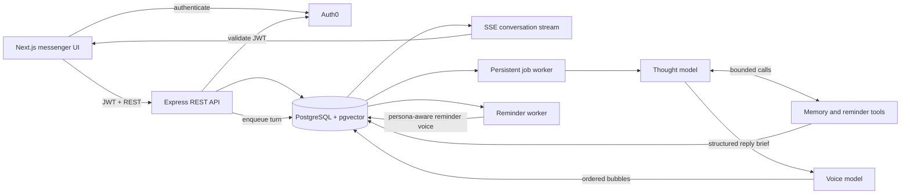
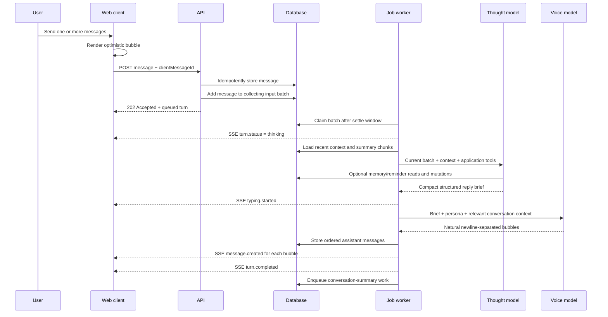
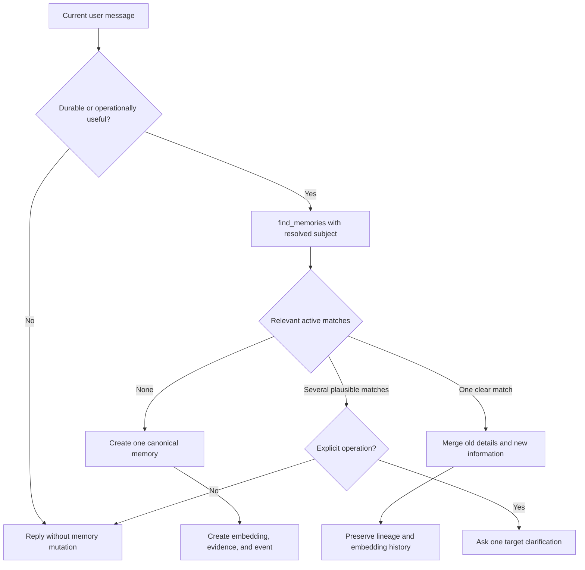
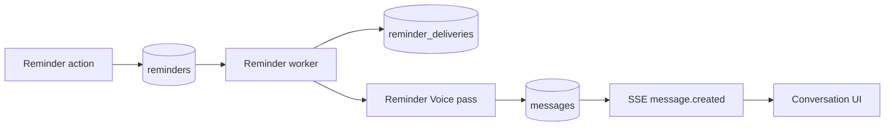

# Cantarella

> A messenger-first personal AI companion with durable memory, natural reminders, and a two-pass Thought → Voice architecture.

Cantarella is designed to feel like an ongoing private conversation—not a prompt box, model picker, or command-driven assistant. Each account has one continuous conversation, one evolving persona, and a memory layer that can preserve useful context without turning every message into a database record.

The current V1 is a desktop web application. It includes authenticated onboarding, real-time chat, configurable personality, long-term memory, conversation summaries, and reminders delivered back into the conversation.

## Contents

- [Product principles](#product-principles)
- [Current features](#current-features)
- [Architecture](#architecture)
- [Message lifecycle](#message-lifecycle)
- [Two-pass model pipeline](#two-pass-model-pipeline)
- [Memory system](#memory-system)
- [Conversation summaries](#conversation-summaries)
- [Reminder system](#reminder-system)
- [Reliability model](#reliability-model)
- [API](#api)
- [Data model](#data-model)
- [Technology](#technology)
- [Project structure](#project-structure)
- [Local development](#local-development)
- [Testing](#testing)
- [Roadmap](#roadmap)

## Product principles

### Messenger first

The chat surface follows familiar messenger behavior:

- one persistent Cantarella conversation per user
- ordinary left/right message bubbles
- multiple nearby user messages collected into one conversational turn
- multiple assistant bubbles when the response naturally needs them
- optimistic sending, sent/seen states, typing feedback, and progressive delivery
- paginated, virtualized history instead of loading the entire conversation at once

The interface deliberately avoids chatbot conventions such as model selectors, prompt templates, new-chat buttons, visible tool calls, and memory-operation confirmations.

### Thought and voice are separate responsibilities

The first model determines meaning, context, actions, and grounded response points. The second model turns that brief into Cantarella's actual conversational wording. This allows reasoning and tool use to remain constrained while the visible response remains natural.

### Memory is selective and correctable

Cantarella should remember information that will matter later—not every passing sentence. Existing memories are searched before any save, so corrections and new details can update one canonical record instead of creating contradictions or erasing useful context.

### Application actions stay invisible

Memory and reminder operations happen behind the conversation. The user speaks naturally; the model resolves the intent and invokes bounded application tools. The voice response discusses the actual subject rather than narrating internal storage operations.

## Current features

| Area | V1 behavior |
| --- | --- |
| Authentication | Auth0 SPA login with backend JWT validation |
| Account bootstrap | First login atomically creates settings, persona, and one primary conversation |
| Onboarding | Timezone, preferred name, voice direction, optional style additions, and boundaries |
| Chat | Durable messages, nearby-message batching, cursor pagination, and virtualized rendering |
| Real-time updates | Server-Sent Events for turn state, typing, new bubbles, completion, and failure |
| AI pipeline | Configurable Thought model followed by a separate Voice model |
| Persona | Immutable core SOUL plus per-user voice direction, custom style, and boundaries |
| Memory | Automatic and manual create/read/update/delete with embeddings, evidence, and lineage |
| Summaries | Immutable summary chunks for older conversation history |
| Reminders | Chat-created or manually managed reminders with recurrence and in-chat delivery |
| Failure handling | Persistent jobs, bounded retries, idempotent sends, stale-job recovery, and visible failed turns |
| Settings | Profile, persona, timezone, and quiet-hours management |

## Architecture



There is no separate queue service in V1. Jobs, locks, retry state, deduplication keys, reminder deliveries, and recovery metadata are stored in PostgreSQL.

## Message lifecycle



### 1. Idempotent message acceptance

The client generates a UUID `clientMessageId` before sending. The backend stores the message with a uniqueness constraint scoped to the conversation. Repeating the same request returns the existing message; reusing the UUID for different content is rejected.

### 2. Nearby-message batching

New messages enter a collecting input batch. Every additional message received during `MESSAGE_SETTLE_MS` extends the batch's settle time. This lets a user send several short bubbles naturally while producing one coherent model turn.

The order of user messages and assistant bubble parts is explicit in the database, avoiding timestamp-dependent reordering.

### 3. Context construction

The Thought model receives:

- every user message in the current batch
- up to 12 recent unsummarized messages
- recent immutable conversation-summary chunks
- the user's local time and timezone
- application tools for on-demand memory and reminder access

Memory is not blindly dumped into every prompt. The Thought model requests relevant records when the current conversation needs them.

### 4. Durable generation

The API returns `202 Accepted` after the user message and turn are safely stored. Generation runs through a persistent job, so the HTTP request does not need to remain open while both model passes complete.

### 5. Ordered bubble delivery

The Voice output is split on newline boundaries. Each bubble is stored as its own message with a `partIndex`, then emitted through SSE in order. The frontend can reveal later bubbles progressively while preserving the canonical stored order.

## Two-pass model pipeline

### Pass 1: Thought

The Thought model owns interpretation and application decisions. It:

- classifies the message as social, help, mixed, or unclear
- resolves whether the reply depends on immediate or older context
- interprets corrections, shorthand, and conversational references
- retrieves or mutates memories and reminders through bounded tools
- produces compact semantic reply points and at most one useful question
- never writes the final Cantarella prose

The tool loop permits at most three read calls followed by at most three mutation calls. Reads and mutations cannot be interleaved arbitrarily, duplicate tool calls are quarantined, and every tool payload is validated before execution.

The current default Thought model is configurable through `THOUGHT_MODEL`.

### Pass 2: Voice

The Voice model receives:

- the Thought model's grounded reply brief
- the current user-message batch
- a small slice of immediate conversation
- Cantarella's core SOUL
- the user's selected voice direction and higher-priority custom additions
- whether a real application action succeeded

It decides the natural phrasing and bubble count. Reply points are semantic requirements, not a one-point-to-one-bubble template.

Voice validation rejects internal-analysis leakage, application metadata, malformed output, and other contract violations. A failed Voice pass can trigger a bounded regeneration or a safe brief-based fallback when an application action has already committed.

The current default Voice model is configurable through `VOICE_MODEL`.

## Memory system

Memories are canonical records, not copied chat excerpts. Supported memory types are:

- `profile` — stable identity or life context
- `preference` — durable likes, dislikes, and habits
- `relationship` — people and their relationship to the user
- `boundary` — explicit conversational or behavioral boundaries
- `situation` — active projects, pressures, and tracked state
- `event` — dated or otherwise time-bound facts

### Search-before-save protocol



`save_memory` is unavailable to the model until `find_memories` succeeds in the same turn. The runtime enforces the same rule independently, so a prompt mistake cannot bypass it.

The resulting behavior is:

- no relevant record → create a new memory
- one relevant record → update it while preserving useful existing details
- ambiguous passive information → skip the mutation and continue chatting
- ambiguous explicit edit/delete → ask only which target the user meant
- explicit forget/delete with one clear target → permanently delete that memory lineage

Time-bound memories require an absolute expiry derived from the user's timezone. Stable and genuinely open-ended memories may use no expiry.

### Retrieval

Memory retrieval combines:

- pgvector cosine similarity
- PostgreSQL full-text ranking
- stored importance
- recency/reinforcement data
- expiry and active-status filtering

If semantic embedding retrieval is temporarily unavailable, the backend can fall back to non-vector ranking rather than failing the entire conversation.

### Auditability

Memory storage is split across three responsibilities:

- `memories` holds the current canonical record and lineage state
- `memory_evidence` connects a memory to the messages that support or correct it
- `memory_events` records creation, correction, supersession, expiry, deletion, and manual changes

Embedding history is retained separately so corrected memories can reuse or supersede vectors safely.

### Manual management

The Memories screen and REST API support manual create, edit, and delete operations. These use the same canonical storage and embedding rules as chat-driven changes.

## Conversation summaries

Recent messages remain raw; older history is compressed into immutable chunks.

- the newest 15 messages are protected from summarization
- eligible history is summarized in approximately 15-message chunks
- chunks never split a multi-bubble assistant turn
- each chunk stores a concise summary plus unresolved situations
- a new chunk may use the previous chunk for continuity but does not rewrite it
- summary embeddings allow older episodes to be retrieved independently

This avoids recursively compressing one ever-shrinking master summary. Older detail is distributed across immutable chunks, while the latest raw conversation stays available for exact short-term context.

## Reminder system

Reminders can be created from natural chat or managed through the Reminders screen.

### Chat operations

- creating a clearly requested new reminder does not require a lookup
- changing, rescheduling, pausing, resuming, cancelling, or deleting an existing reminder requires `find_reminders`
- one uniquely resolved target can be changed immediately
- ambiguous targets produce one short clarification instead of a guessed mutation
- cancelling keeps a historical record; deleting removes it permanently

### Scheduling and delivery



The reminder worker:

1. atomically claims a due reminder
2. creates or resumes an idempotent delivery record
3. renders the reminder through Cantarella's persona-aware Voice model
4. stores it as a normal in-conversation message
5. emits typing and message events to connected clients
6. calculates the next occurrence for daily, weekly, or monthly recurrence

Failed and stale deliveries are recoverable. Push notification delivery is intentionally outside the current web V1.

## Reliability model

### Persistent jobs

Turn generation and summary creation use database-backed jobs with:

- explicit pending, processing, completed, failed, and cancelled states
- deduplication keys
- priority and scheduled execution time
- bounded attempt counts
- retryable/non-retryable error classification
- lock ownership and timestamps
- periodic stale-lock recovery

### Observable turn state

The client receives these SSE events:

- `turn.status`
- `typing.started`
- `typing.stopped`
- `message.created`
- `turn.completed`
- `turn.failed`

If generation exhausts its retries, the stored user message remains visible with a failed state instead of disappearing silently.

### Model-run records

Each Thought, Voice, summary, memory, and reminder-voice execution can be recorded with its model, provider, prompt version, token usage, estimated cost, latency, status, and bounded error information. These records support debugging without exposing internal operations in the chat UI.

## API

All `/api/v1` routes require a valid Auth0 bearer token. `/ping` is the unauthenticated health check.

Successful responses use:

```json
{
  "data": {}
}
```

Errors use:

```json
{
  "error": {
    "code": "ERROR_CODE",
    "message": "Human-readable description",
    "retryable": false
  }
}
```

### Account and persona

| Method | Route | Purpose |
| --- | --- | --- |
| `POST` | `/api/v1/auth/login` | Bootstrap or load the authenticated account |
| `GET` | `/api/v1/me` | Get current account, settings, persona, and conversation ID |
| `PUT` | `/api/v1/onboarding` | Complete initial profile and persona setup |
| `PUT` | `/api/v1/settings` | Update settings and persona additions |

### Conversation

| Method | Route | Purpose |
| --- | --- | --- |
| `GET` | `/api/v1/conversations/primary` | Get the user's single Cantarella conversation |
| `GET` | `/api/v1/conversations/:id/messages` | Read cursor-paginated message history |
| `POST` | `/api/v1/conversations/:id/messages` | Idempotently accept a user message and queue its turn |
| `GET` | `/api/v1/conversations/:id/events` | Open the authenticated SSE stream |

### Memories

| Method | Route | Purpose |
| --- | --- | --- |
| `GET` | `/api/v1/memories` | List active or filtered memories |
| `POST` | `/api/v1/memories` | Create a manual memory |
| `PATCH` | `/api/v1/memories/:id` | Edit a memory |
| `DELETE` | `/api/v1/memories/:id` | Delete a memory lineage |

### Reminders

| Method | Route | Purpose |
| --- | --- | --- |
| `GET` | `/api/v1/reminders` | List reminders |
| `POST` | `/api/v1/reminders` | Create a reminder manually |
| `PATCH` | `/api/v1/reminders/:id` | Update reminder content, schedule, recurrence, or status |
| `DELETE` | `/api/v1/reminders/:id` | Permanently delete a reminder |

## Data model

The schema is organized by responsibility rather than as one generic chat table.

| Domain | Tables | Responsibility |
| --- | --- | --- |
| Identity | `users`, `user_settings`, `personas` | Auth0 identity, timezone, preferences, and persona versions |
| Conversation | `conversations`, `messages` | One durable conversation and its ordered chat/reminder messages |
| Turn batching | `input_batches`, `input_batch_messages`, `turns` | Collect nearby messages and track generation state |
| Execution | `jobs`, `model_runs` | Persistent work, retries, provider/model audit data |
| Memory | `memories`, `memory_evidence`, `memory_events`, `memory_embeddings` | Canonical facts, provenance, lineage, and vector history |
| Summaries | `conversation_summaries`, `conversation_summary_embeddings` | Immutable historical chunks and semantic retrieval |
| Reminders | `reminders`, `reminder_deliveries` | Schedules, recurrence, delivery idempotency, and retry state |

Public identifiers are UUIDs. Foreign keys, check constraints, partial unique indexes, and transactional row locks protect invariants that should not depend on model behavior.

## Technology

### Frontend

- Next.js 16 App Router
- React 19 and TypeScript
- Tailwind CSS 4
- Auth0 React SDK
- React Virtuoso for long, virtualized conversation history
- Native `fetch` streaming for SSE

### Backend

- Node.js 20+
- Express 5 and TypeScript
- Drizzle ORM and Drizzle migrations
- PostgreSQL with pgvector
- Zod at HTTP, model, and tool boundaries
- Pino structured logging
- Vitest and Supertest
- OpenRouter for Thought, Voice, summary, reminder-voice, and embedding requests

## Project structure

```text
cantarella-revamped/
├── backend/
│   ├── drizzle/                 # Versioned SQL migrations
│   ├── scripts/                 # Build-time helpers
│   ├── src/
│   │   ├── api/                 # Account, conversation, memory, reminder routes
│   │   ├── auth/                # Auth0 access-token validation
│   │   ├── db/                  # Drizzle schema, client, migration entrypoint
│   │   ├── events/              # In-process SSE event bus
│   │   ├── jobs/                # Persistent worker and recovery logic
│   │   ├── memory/              # Canonical memory, embeddings, retrieval, lineage
│   │   ├── models/              # OpenRouter, Thought, Voice, embedding adapters
│   │   ├── persona/             # Voice-direction configuration
│   │   ├── pipeline/            # Turn preparation and two-pass orchestration
│   │   ├── prompts/             # Core SOUL and persona composition
│   │   ├── reminders/           # Scheduling, actions, delivery worker
│   │   ├── summary/             # Chunking, policy, retrieval, processing
│   │   └── tools/               # Bounded Thought-model application tools
│   └── tests/                   # Backend unit and integration tests
├── frontend/
│   └── app/
│       ├── auth/                # Login and authenticated bootstrap
│       ├── chat/                # Messenger UI and SSE state handling
│       ├── memories/            # Manual memory management
│       ├── onboarding/          # Initial persona and timezone setup
│       ├── reminders/           # Reminder management
│       └── settings/            # Account and persona settings
├── PLAN.md                      # Detailed release planning and design history
└── README.md
```

## Local development

This repository expects access to a PostgreSQL database with the pgvector extension available. Database hosting and deployment topology are intentionally left to the operator; the application connects through `DATABASE_URL`.

### Prerequisites

- Node.js 20 or newer
- PostgreSQL with pgvector enabled
- an Auth0 Single Page Application and API
- an OpenRouter API key

### Install dependencies

```bash
git clone <repository-url>
cd cantarella-revamped

cd backend
npm install

cd ../frontend
npm install
```

### Backend environment

Create `backend/.env` from `backend/.env.example` and provide real values:

```dotenv
NODE_ENV=development
PORT=3001
DATABASE_URL=postgresql://<user>:<password>@<host>:<port>/<database>

AUTH0_DOMAIN=<tenant>.auth0.com
AUTH0_AUDIENCE=https://cantarella.api

OPENROUTER_API_KEY=<openrouter-key>
THOUGHT_MODEL=deepseek/deepseek-v4-pro-0813
VOICE_MODEL=aion-labs/aion-3.0-mini
EMBEDDING_MODEL=openai/text-embedding-3-small

MESSAGE_SETTLE_MS=1200
MODEL_TIMEOUT_MS=120000
JOB_POLL_MS=500
```

No model-provider secret belongs in the frontend environment.

### Frontend environment

Create `frontend/.env.local`:

```dotenv
NEXT_PUBLIC_API_URL=http://localhost:3001
NEXT_PUBLIC_AUTH0_DOMAIN=<tenant>.auth0.com
NEXT_PUBLIC_AUTH0_CLIENT_ID=<spa-client-id>
```

The Auth0 audience used by the frontend must match `AUTH0_AUDIENCE` in the backend. Add the frontend origin as an allowed callback, logout, and web origin in the Auth0 SPA configuration.

### Apply migrations

From `backend/`:

```bash
npm run db:migrate
```

Migrations are versioned under `backend/drizzle/`. Generate a new migration after intentional schema changes with:

```bash
npm run db:generate
```

Review generated SQL before applying it.

### Start the application

In separate terminals:

```bash
cd backend
npm run dev
```

```bash
cd frontend
npm run dev
```

The frontend runs on `http://localhost:3000` by default and calls the backend URL configured in `NEXT_PUBLIC_API_URL`.

## Testing

Run backend tests and static type checking:

```bash
cd backend
npm test
npm run typecheck
```

Run frontend linting:

```bash
cd frontend
npm run lint
```

Backend tests cover HTTP contracts, auth bootstrap behavior, message batching, model and tool contracts, memory lifecycle, reminder scheduling, summary chunking, ordering, retries, and fallback paths.

## Roadmap

### V1 — Desktop web experience

The current release focuses on the complete private-assistant loop: authenticate, talk naturally, receive persona-consistent replies, retain useful context, and deliver reminders reliably.

### V1.5 — Mobile enablement

Planned work is intentionally narrow:

- Capacitor packaging for Android and iOS
- mobile Auth0 redirects and token refresh
- resume/reconnect behavior
- safe send retry after connection loss
- push delivery for reminders when the app is closed

### V2 — The “alive” layer

Later intelligence may add persistent mood/context state, learned notification timing, proactive but suppressible check-ins, silence detection, weekly recaps, and stronger self-correction. These features must build on the existing memory and reliability contracts rather than bypass them.

### V3 — Optional messenger and agency features

Lower-priority additions include quoted replies, reactions, attachments, conversation search, richer delivery indicators, multi-device presence, calendar awareness, goals, focus modes, web search, and broader integrations.

Tasks are deliberately not part of V1. Reminder delivery is implemented; full task/project tracking remains deferred because it needs a separate structured lifecycle rather than being disguised as generic memory.
