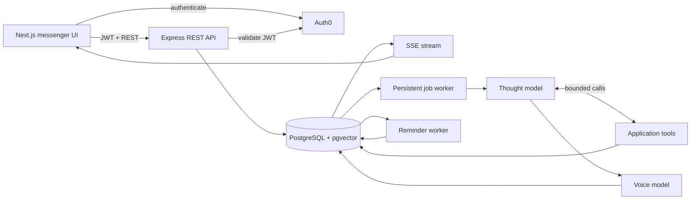
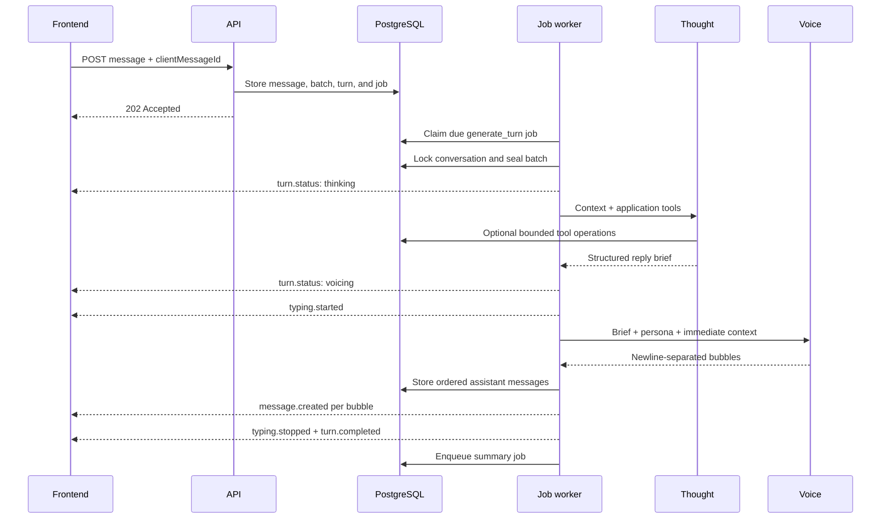
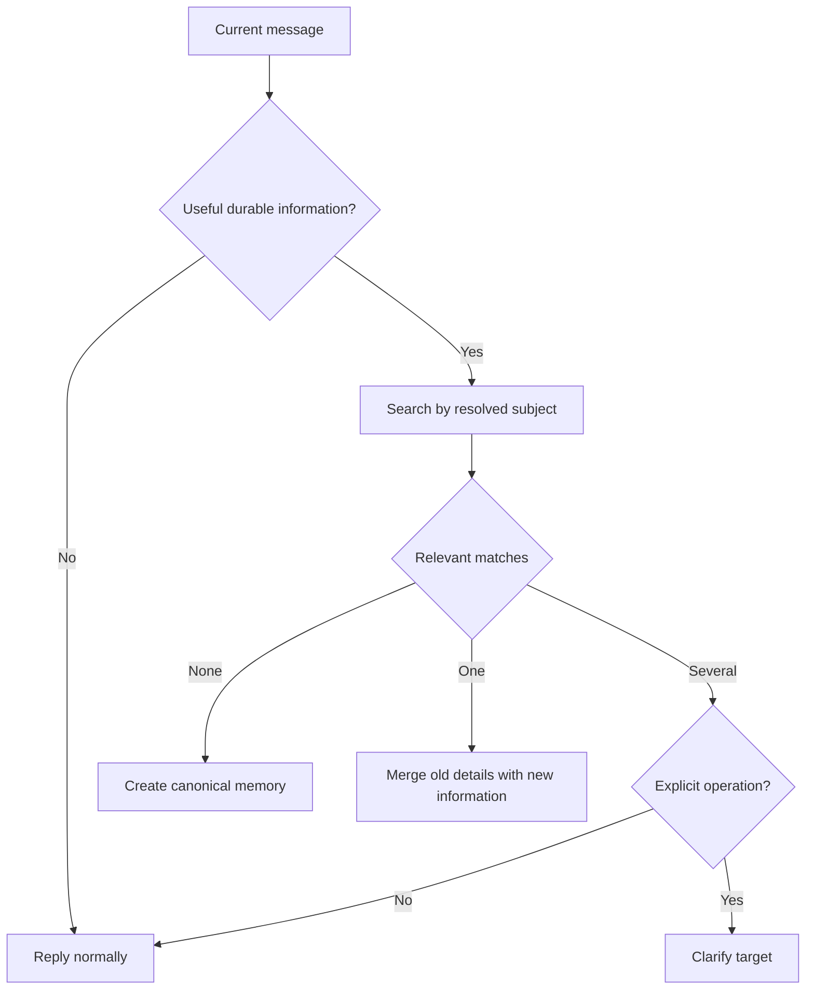

# Cantarella Architecture

This document describes the implementation behind Cantarella V1. For the product overview and setup instructions, see the [root README](../README.md). For HTTP and event contracts, see the [API reference](API.md).

## Design goals

Cantarella is built around four constraints:

1. The product should behave like a private messenger, not a model interface.
2. Reasoning, application actions, and visible prose should have separate contracts.
3. Memory changes must be safe even when the model makes a poor decision.
4. A slow or interrupted two-pass generation must not lose accepted user messages.

## System overview



V1 does not require a separate queue service. Jobs, retry state, locks, deduplication keys, reminder deliveries, and recovery metadata are stored in PostgreSQL.

## Authentication and account bootstrap

The frontend uses Auth0's SPA redirect flow. It sends the resulting bearer token to the API, where `express-oauth2-jwt-bearer` validates:

- issuer derived from `AUTH0_DOMAIN`
- audience from `AUTH0_AUDIENCE`
- RS256 signature
- required issuer and subject claims

The first authenticated login atomically creates:

- a `users` identity record
- default `user_settings`
- one `personas` record
- one primary `conversations` record

Every account owns exactly one Cantarella conversation. Persona configuration is edited from onboarding or settings rather than swapped inside the chat.

## Message acceptance and batching

### Idempotency

The client generates a UUID `clientMessageId` before each send. A partial unique index scopes it to the conversation.

- a repeated request with identical content returns the stored message
- reusing the UUID with different content or origin returns a conflict
- the user message is durable before model generation begins

### Collection window

Messages enter an `input_batches` record in `collecting` state. New messages arriving before the settle deadline join that batch and extend `settle_at` by `MESSAGE_SETTLE_MS`.

`input_batch_messages.position` preserves the user's intended order. One queued turn and one deduplicated `generate_turn` job belong to the batch.

This lets a user send an arbitrary number of nearby short messages without causing separate overlapping replies.

## Turn lifecycle



Turn states are:

```text
queued → thinking → voicing → completed
                            ↘ failed
```

Terminal turns may also be cancelled when their work is obsolete.

## Context construction

The Thought model receives:

- all messages in the current input batch
- up to 12 recent unsummarized messages
- recent immutable conversation-summary chunks
- the user's authoritative local date and time
- tools for on-demand memory and reminder access
- a rejected brief on the single bounded repair attempt, when applicable

The context builder loads more history internally to locate the summary cursor but does not replay the entire conversation into every model request.

The Voice model receives the current batch and a smaller slice of immediate conversation. It does not receive unrestricted application control.

## Two-pass model contract

### Thought responsibilities

Thought determines:

- `messageMode`: social, help, mixed, or unclear
- `contextRelation`: standalone, immediate context, or older context
- the semantic points the reply must communicate
- whether one useful clarification question is needed
- memory and reminder operations through supplied tools

It does not write Cantarella's final prose.

### Bounded tool loop

The model may use at most:

- three read calls
- followed by three mutation calls
- with no return to the read phase after mutation starts

The runtime rejects:

- unknown tool names
- malformed arguments
- duplicate calls
- mixed read and mutation execution in one stage
- calls beyond the configured bounds
- invented or unapproved record IDs
- multiple mutations of the same target in one turn

Read-tool target resolution is authoritative. Existing-record mutations may use only the returned `allowedTargetId`.

### Voice responsibilities

Voice receives the Thought brief, immediate context, persona, and application-success state. It controls:

- actual conversational wording
- contractions and informal phrasing
- response length appropriate to the moment
- the number of visible bubbles
- whether a question should become a separate bubble

Thought reply points are semantic requirements, not a bubble template.

Voice validation rejects internal analysis, schema leakage, tool narration, and malformed output. A rejected grounded brief can trigger one new Thought attempt. If an application mutation has already committed, the pipeline uses a safe brief-derived fallback rather than risking duplicate actions.

## Persona composition

Persona instructions have an explicit priority order:

1. Cantarella's complete core SOUL
2. one selected voice direction: default, softer, firmer, playful, nurturing, or intimate
3. the user's custom style additions
4. explicit user boundaries, which win when a conflict exists

Voice direction is an additive mode, not a replacement for the core persona. Empty or low-quality onboarding input still produces the baseline Cantarella voice.

## Memory architecture

### Types

Canonical memories use six types:

- `profile`
- `preference`
- `relationship`
- `boundary`
- `situation`
- `event`

Each record stores canonical text, importance, confidence, state, lineage, normalized hash, reinforcement time, and optional expiry.

### Search-before-save

Every create or update must begin with `find_memories` in the same turn. This is enforced twice:

1. `save_memory` is hidden from the model until lookup succeeds.
2. The application runtime rejects a direct save without a successful lookup.



Corrections update a canonical record instead of sitting beside it. A dynamic tracked value remains one memory. Explicit deletion removes the entire selected lineage.

### Expiry

Time-bound situations and events require an absolute RFC 3339 expiry resolved using the user's timezone. Retrieval excludes records after `expires_at` even when their stored status has not yet been transitioned.

Stable or genuinely open-ended information may have no expiry.

### Retrieval

Semantic retrieval combines:

- pgvector cosine similarity
- stored importance
- confidence
- a small boundary-memory priority
- active state and expiry filters

The manual memory interface additionally supports exact filtering and substring search. If query embedding generation is unavailable, retrieval fails soft rather than failing the entire turn.

### Evidence and lineage

Memory responsibility is separated across:

- `memories` — current canonical record and lineage state
- `memory_evidence` — supporting, reinforcing, correcting, or contradicting messages
- `memory_events` — auditable lifecycle transitions
- `memory_embeddings` — current and superseded semantic representations

Manual and conversational edits share canonical hashing, duplicate protection, embedding history, and lineage rules.

## Conversation summaries

Summaries are immutable historical chunks rather than one recursively compressed document.

- the newest 15 messages remain protected as raw context
- approximately 15 eligible messages form each new chunk
- a chunk boundary never divides one assistant turn
- each chunk stores summary text plus explicitly unresolved situations
- the previous chunk may provide continuity but is not rewritten
- every chunk has its own embedding and retrieval identity
- one summary job can catch up several chunks within a bounded loop

This prevents early history from being repeatedly compressed until its details disappear.

## Reminder architecture

### Tool policy

New reminder creation is allowed without a search because it creates a new future interruption. Existing reminder operations require `find_reminders`:

- update
- reschedule
- pause
- resume
- cancel
- permanent delete

Cancel and delete are distinct. Cancel retains a record; delete removes it.

### Scheduling

The scheduler supports:

- absolute local date and time
- relative delays in minutes, hours, or days
- daily, weekly, and monthly recurrence

Timezone conversion occurs in the backend, not inside visible model prose.

### Delivery

The reminder worker atomically claims a due reminder with row locking, creates or resumes an idempotent delivery, and temporarily clears `next_run_at` while processing.

It then:

1. emits `typing.started`
2. runs a dedicated persona-aware reminder Voice pass
3. stores the result as normal reminder-kind messages
4. emits each `message.created` event
5. calculates the next recurrence or completes the reminder
6. emits `typing.stopped`

Stale processing deliveries are recovered. Failed delivery restores the due occurrence for another attempt when safe.

## Persistent jobs and failure handling

Supported jobs include turn generation and conversation summarization. Job records contain:

- state
- priority
- scheduled run time
- attempt and maximum-attempt counts
- deduplication key
- lock owner and timestamp
- last error code and message
- completion time

Workers use `FOR UPDATE SKIP LOCKED` to claim work safely. Retryability is derived from provider and embedding errors; backoff increases by attempt count. A periodic recovery pass releases processing jobs whose locks are older than the stale threshold.

When a turn ultimately fails:

- its user message remains stored
- the turn becomes `failed`
- its input batch is cancelled
- typing stops
- the client receives `turn.failed`
- the sender sees a visible failed-message state

## Ordered storage and delivery

Assistant bubbles share a turn ID and have increasing `part_index` values. Their stored timestamps are offset by one millisecond per part, but ordering logic prioritizes the explicit part index when messages belong to the same turn.

The frontend uses React Virtuoso to render long histories without mounting every message. Initial and older pages are cursor-based, with a default page size of 50.

## Data model

| Domain | Tables | Responsibility |
| --- | --- | --- |
| Identity | `users`, `user_settings`, `personas` | Auth identity, timezone, and persona version |
| Conversation | `conversations`, `messages` | Single durable chat and ordered bubbles |
| Batching | `input_batches`, `input_batch_messages`, `turns` | Nearby inputs and generation lifecycle |
| Execution | `jobs`, `model_runs` | Durable work, retries, and model audit data |
| Memory | `memories`, `memory_evidence`, `memory_events`, `memory_embeddings` | Canonical context, provenance, lineage, vectors |
| Summaries | `conversation_summaries`, `conversation_summary_embeddings` | Immutable older-context chunks |
| Reminders | `reminders`, `reminder_deliveries` | Scheduling, recurrence, and idempotent delivery |

Foreign keys, partial unique indexes, checks, and transactional locks enforce invariants independently of model behavior.

## Model-run observability

Thought, Voice, summary, memory, and reminder-voice runs may record:

- phase
- provider and model
- prompt and persona version
- sanitized input and parsed output
- bounded raw output for debugging
- input/output token counts
- estimated cost
- latency
- error code and message

These records are operational diagnostics and are not displayed as chat metadata.

## Current boundaries

V1 intentionally excludes:

- push notifications
- native mobile packaging
- proactive heartbeat messages
- calendar and external-system integrations
- structured goals and tasks
- attachments, reactions, and quoted replies
- advanced cross-device presence and synchronization

Those capabilities are staged in later releases so they cannot delay the core conversation, memory, and reminder contracts.
